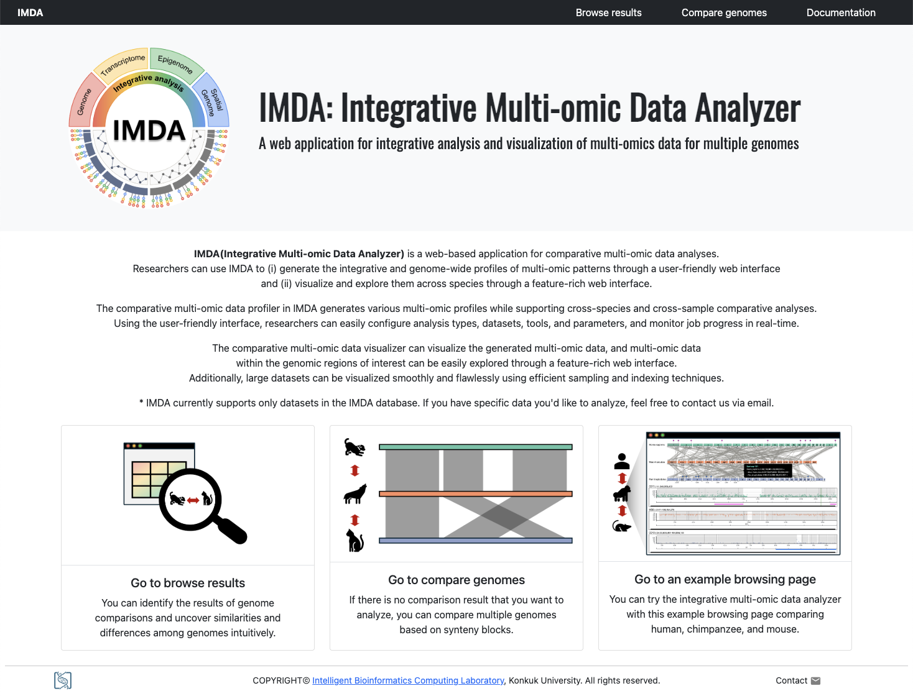

# IMDA: Integrative Multi-omic Data Analyzer

**IMDA (Integrative Multi-omic Data Analyzer)** is a web-based platform designed to facilitate comparative multi-omic data analysis across diverse species and samples. By integrating genomic, transcriptomic, and epigenomic data with genome-based comparative analysis, IMDA enables users to explore conserved and divergent molecular features across species.

**Web platform:** https://biweb.konkuk.ac.kr/IMDA/

## Source Code

This repository contains the source code of the IMDA web platform, including its comparative multi-omic data profiling, comparison, and interactive visualization.

## Database Snapshots

The `db_info_*` directories contain periodically updated snapshots of the IMDA database, providing information about reference genome assemblies and available multi-omic datasets.

Each snapshot is organized into a version-specific directory (e.g., `db_info_v261122/`) to preserve database information at the time of release.

New snapshots will be added periodically to reflect updates to the IMDA database.
